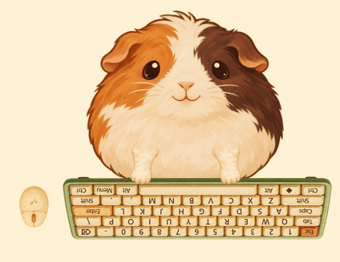

  

<h1 align="center">豚鼠键盘</h1>

  住在 Windows 和 macOS 桌面上的小荷兰猪。 
  你打字，它就用小爪敲键盘。你移动鼠标，它也抬眼跟着看。

  <a href="https://github.com/gwtt/guinea-pig-keyboard">GitHub</a> ·
  <a href="https://github.com/gwtt/guinea-pig-keyboard/releases/latest/download/WheekKeys.exe">下载 Windows 版</a> ·
  <a href="https://github.com/gwtt/guinea-pig-keyboard/releases/latest/download/WheekKeys-macOS.zip">下载 macOS 版</a> ·
  <a href="https://github.com/gwtt/guinea-pig-keyboard/issues/new">反馈问题</a>

  
  

Windows 10 或 11 用户下载后双击 `WheekKeys.exe` 即可。Mac 用户（macOS 11 或更新版本）解压后把 `WheekKeys.app` 拖进「应用程序」。第一次打开，从菜单栏的荷兰猪图标选择「启用输入监控权限」，允许后重新打开桌宠，它就能跟着你打字了。Mac 版尚未经 Apple 公证，若系统阻止打开，可查看 [Apple 的说明](https://support.apple.com/zh-cn/102445)。

按住荷兰猪可以拖动，右键打开设置，点选喜欢的毛色，下次打开还是它。开启鼠标穿透后，也能从 Windows 托盘或 macOS 菜单栏打开设置。每只都会偶尔眨眼，你移动鼠标时，它的目光也会跟着转。

非盈利的vibe项目，纯粹分享给同样喜欢荷兰猪的朋友。

感谢 [BongoCat](https://github.com/KeyLimePie7/BongoCat)、[DesktopKitty](https://github.com/MayankArambhi/DesktopKitty) 提供的参考，以及 [7paws](https://github.com/7wdn/7paws) 的美术参考。

## ☕ Buy me a coffee

如果这只小豚鼠让你开心，欢迎请我喝杯咖啡。

| 支付宝 | 微信支付 |
| :---: | :---: |
|  |  |
