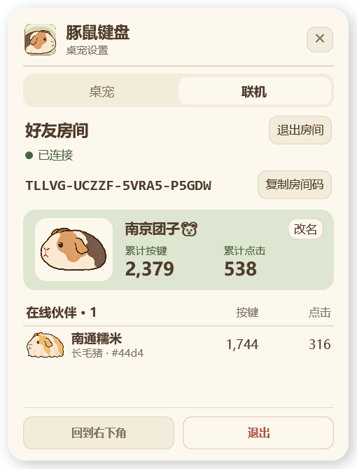

  

<h1 align="center">豚鼠键盘</h1>

  住在 Windows 和 macOS 桌面上的小荷兰猪。 
  你打字，它就用小爪敲键盘。你移动鼠标，它也抬眼跟着看。

  <a href="https://github.com/gwtt/guinea-pig-keyboard">GitHub</a> ·
  <a href="https://github.com/gwtt/guinea-pig-keyboard/releases/latest/download/WheekKeys.exe">下载 Windows 版</a> ·
  <a href="https://github.com/gwtt/guinea-pig-keyboard/releases/latest/download/WheekKeys-macOS.zip">下载 macOS 版</a> ·
  <a href="https://github.com/gwtt/guinea-pig-keyboard/issues/new">反馈问题</a>

  
  

Windows 10 或 11 用户下载后双击 `WheekKeys.exe` 即可。Mac 用户（macOS 11 或更新版本）解压后把 `WheekKeys.app` 拖进「应用程序」。第一次打开，从菜单栏的荷兰猪图标选择「启用输入监控权限」，允许后重新打开桌宠，它就能跟着你打字了。Mac 版尚未经 Apple 公证，若系统阻止打开，可查看 [Apple 的说明](https://support.apple.com/zh-cn/102445)。

按住荷兰猪可以拖动，右键打开设置，点选喜欢的毛色，下次打开还是它。开启鼠标穿透后，也能从 Windows 托盘或 macOS 菜单栏打开设置。每只都会偶尔眨眼，你移动鼠标时，它的目光也会跟着转。

Windows 版新增 14 款像素外观，原有 6 款仍保留。像素源图位于 `assets/pixel`，底图为 100×104 像素，眼睛由程序绘制；修改资源后重新运行 `build.ps1` 构建。像素皮肤联机时使用既有兼容外观标识，因此好友端显示对应的兼容外观，名字和计数仍按原协议发送。macOS 本次未增加像素渲染，现有 6 款保持不变。

Windows 构建后可运行 `tools/test-pixel-skins.ps1`，使用临时配置检查皮肤切换、保存、动画生命周期和联机数据解析；检查不会加入真实房间。

打开设置里的「联机」，在自己的小猪卡片上点「改名」就能起名字，留空保存会恢复显示毛色名。名字保存在当前电脑，重启后仍然有效。卡片也会显示累计按键和点击次数。长按键盘只算一次，鼠标统计左键和右键。

### 和异地的朋友一起敲键盘

两人都运行带有「好友房间」的 0.1.4 版。一个人打开「设置 → 联机」，点「创建房间」，把房间码复制给朋友。朋友在自己的联机页粘贴房间码，点「加入」。房间连接成功后，几秒内就能看到彼此的小猪、名字和累计次数。关掉设置面板也可以继续联机。

好友房间通过公网中转，双方都从自己的网络连到中转，无需配置路由器。桌宠每 5 秒用房间密钥加密并发送会话编号、名字、毛色和两个累计数。房间码也是加入凭据，分享给想一起玩的朋友即可。默认使用 [EMQX 公共测试中转](https://www.emqx.com/zh/mqtt/public-mqtt5-broker)。

网络中断时桌宠会自动重连。使用自备 MQTT 中转时，双方可以将环境变量 `WHEEKKEYS_ROOM_BROKER` 设为同一个支持 MQTT 3.1.1 的 `wss://` 地址后重启桌宠。

两台电脑在同一网络时，也可以选「局域网发现」，直接通过 UDP 41684 找到彼此。

默认启用「使用搜狗输入法时自动隐藏」。切到搜狗，桌宠会收起并继续计数。切回其他输入法，它会重新出现。隐藏时仍可从托盘或菜单栏打开设置。Windows 开启「允许我为每个应用窗口使用不同的输入法」时，部分搜狗版本可能无法识别。

非盈利的vibe项目，纯粹分享给同样喜欢荷兰猪的朋友。

感谢 [BongoCat](https://github.com/KeyLimePie7/BongoCat)、[DesktopKitty](https://github.com/MayankArambhi/DesktopKitty) 提供的参考。

## ☕ Buy me a coffee

如果这只小豚鼠让你开心，欢迎请我喝杯咖啡。

| 支付宝 | 微信支付 |
| :---: | :---: |
|  |  |
