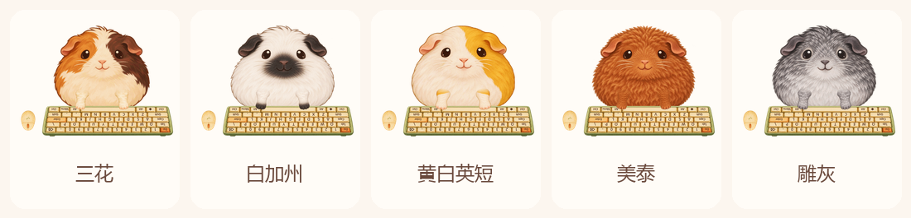

# 豚鼠键盘

一只陪你用电脑的荷兰猪。你打字，它就用两只前爪敲键盘；你移动或点击鼠标，它也会伸爪摆弄自己的鼠标。

**[下载 Windows 版](https://github.com/gwtt/guinea-pig-keyboard/releases/latest/download/WheekKeys.exe)** · **[下载 macOS 版](https://github.com/gwtt/guinea-pig-keyboard/releases/latest/download/WheekKeys-macOS.zip)** · [所有版本](https://github.com/gwtt/guinea-pig-keyboard/releases)

Windows 10 或 11 用户下载后双击 `WheekKeys.exe` 即可。Mac 用户（macOS 11 或更新版本）解压后把 `WheekKeys.app` 拖进「应用程序」。第一次打开，从菜单栏的荷兰猪图标选择「启用输入监控权限」，允许后重新打开桌宠，它就能跟着你打字了。Mac 版尚未经 Apple 公证，若系统阻止打开，可查看 [Apple 的说明](https://support.apple.com/zh-cn/102445)。

按住它可以拖动。右键点荷兰猪，选「切换外观」就能挑喜欢的那只，下次打开还是它。每只都会偶尔眨眼，你移动鼠标时，它的目光也会跟着转。

非盈利的vibe项目，纯粹分享给同样喜欢荷兰猪的朋友。

感谢 [BongoCat](https://github.com/KeyLimePie7/BongoCat) 和 [DesktopKitty](https://github.com/MayankArambhi/DesktopKitty) 提供的参考。

## ☕ Buy me a coffee

如果这只小豚鼠让你开心，欢迎请我喝杯咖啡。

| 支付宝 | 微信支付 |
| :---: | :---: |
|  |  |
