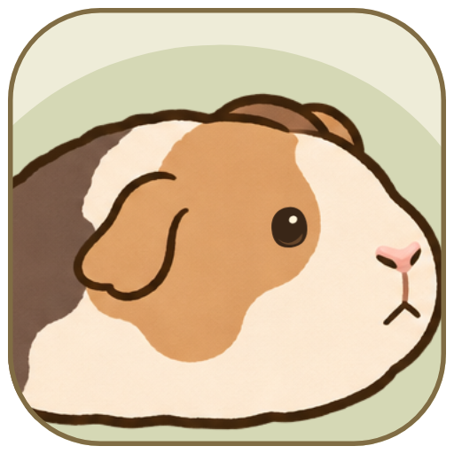

  

<h1 align="center">豚鼠键盘</h1>

  住在 Windows 和 macOS 桌面上的小荷兰猪。 
  你打字，它就用小爪敲键盘，嘴巴也会轻轻动一下。鼠标移动时它会跟着看，滚动时会伸爪拨滚轮。 
  30 秒没动键鼠，它也会打盹。再碰键鼠，它就醒了。

  <a href="https://github.com/gwtt/guinea-pig-keyboard">GitHub</a> ·
  <a href="https://github.com/gwtt/guinea-pig-keyboard/releases/latest/download/WheekKeys.exe">下载 Windows 版</a> ·
  <a href="https://github.com/gwtt/guinea-pig-keyboard/releases/latest/download/WheekKeys-macOS.zip">下载 macOS 版</a> ·
  <a href="https://github.com/gwtt/guinea-pig-keyboard/issues/new">反馈问题</a>

  
  

Windows 10 或 11 用户下载后双击 `WheekKeys.exe` 即可。Mac 用户（macOS 11 或更新版本）解压后把 `WheekKeys.app` 拖进「应用程序」。第一次打开，从菜单栏的荷兰猪图标选择「启用输入监控权限」，允许后重新打开桌宠，它就能跟着你打字了。Mac 版尚未经 Apple 公证，若系统阻止打开，可查看 [Apple 的说明](https://support.apple.com/zh-cn/102445)。

按住荷兰猪可以拖动，右键打开设置，点选喜欢的毛色，下次打开还是它。开启鼠标穿透后，也能从 Windows 托盘或 macOS 菜单栏打开设置。Windows 的「桌宠设置」旁会显示当前版本。

Windows 版闲置 30 秒后会逐渐眯眼，头旁浮起 Zzz；按键、移动、点击或滚动鼠标会让它一激灵醒来，短促抬头抖动后回到原位，再慢慢伸手握鼠标，约 1.6 秒恢复正常动作。小猪还会偶尔轻轻吧唧两下嘴，睡着时也能动嘴，惊醒时暂停。嘴巴使用独立口型素材，正常状态下能看见粉色的小嘴和下方的小弧线，动画时沿用轻微收紧、松开的效果，保持脸型和外轮廓；眼睛保留纯色圆眼。好友桌宠按收到的动作独立入睡与唤醒。

Windows 和 macOS 都提供 14 款像素外观。升级后，旧皮肤会自动换成接近的像素花色。像素源图位于 `assets/pixel`。双方使用新版 Windows 程序时，联机可以显示具体的像素花色。macOS 和旧版好友端通过兼容花色显示在线伙伴，名字和计数继续按原协议发送。

Windows 构建后可运行 `tools/test-pixel-skins.ps1`，使用临时配置检查皮肤切换、保存、动画生命周期和联机数据解析；检查不会加入真实房间。

`tools/test-friend-network.ps1` 使用两个本地回环临时端口检查好友消息与动作同步，并验证好友的等比例缩放、显隐和窗口清理，不访问公网房间。

`tools/test-sleep-animation.ps1` 和 `tools/test-mouth-animation.ps1` 分别检查闲置惊醒与动作恢复、14 款像素外观的嘴部张合、原图与透明轮廓保护、转头兼容及计时器清理。

打开设置里的「联机」，在自己的小猪卡片上点「改名」就能起名字，留空保存会恢复显示毛色名。名字保存在当前电脑，重启后仍然有效。卡片也会显示累计按键和点击次数。长按键盘只算一次，鼠标统计左键和右键。

### 和异地的朋友一起敲键盘

两人都运行新版 Windows 程序。一个人打开「设置 → 联机」，点「创建房间」，把房间码复制给朋友。朋友在自己的联机页粘贴房间码，点「加入」。连接成功后，好友的小猪和完整键盘会自动出现在自己的桌面上。好友桌宠统一使用本机桌宠的缩放比例，对方在自己电脑上调整大小不会改变你的显示。可以单独拖动好友的小猪，看到对方敲键时的爪子、按键高亮和按键气泡，以及鼠标左右键点击。关掉设置面板也可以继续联机；对方离线后，桌面伙伴会在连接超时后移除。

好友名字显示在小猪头顶。清醒时，小猪会跟着本机鼠标转头；睡着后保持睡姿，本机鼠标移动不会唤醒好友小猪。

好友房间通过公网中转，双方都从自己的网络连到中转，无需配置路由器。桌宠每 5 秒用房间密钥加密并发送会话编号、名字、毛色和两个累计数，按键和点击动作实时发送。联机页的「同步按键和鼠标动作」控制本次运行是否共享自己的具体按键及鼠标左右键动作；关闭后仍显示在线状态和累计次数。旧版或 macOS 好友显示为「旧版 · 仅外观」，需要更新 Windows 程序才能同步动作。房间码也是加入凭据，分享给想一起玩的朋友即可。默认使用 [EMQX 公共测试中转](https://www.emqx.com/zh/mqtt/public-mqtt5-broker)。

网络中断时桌宠会自动重连。使用自备 MQTT 中转时，双方可以将环境变量 `WHEEKKEYS_ROOM_BROKER` 设为同一个支持 MQTT 3.1.1 的 `wss://` 地址后重启桌宠。

两台电脑在同一网络时，也可以选「局域网发现」，直接通过 UDP 41684 找到彼此。

默认启用「使用搜狗输入法时自动隐藏」。切到搜狗，桌宠会收起并继续计数。切回其他输入法，它会重新出现。隐藏时仍可从托盘或菜单栏打开设置。Windows 开启「允许我为每个应用窗口使用不同的输入法」时，部分搜狗版本可能无法识别。

非盈利的vibe项目，纯粹分享给同样喜欢荷兰猪的朋友。

感谢 [BongoCat](https://github.com/KeyLimePie7/BongoCat)、[DesktopKitty](https://github.com/MayankArambhi/DesktopKitty) 提供的参考。

## ☕ Buy me a coffee

如果这只小豚鼠让你开心，欢迎请我喝杯咖啡。

| 支付宝 | 微信支付 |
| :---: | :---: |
|  |  |
